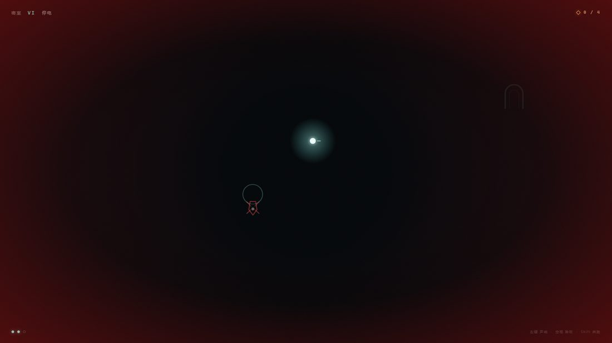

# EARSHOT

> 你什么都看不见。黑暗在听。
>
> *A sonar stealth game played in the dark.*
>
> 接手开发请看 [docs/DEVELOPMENT.md](docs/DEVELOPMENT.md)：目录结构、工具链、踩过的坑、下一步计划。

**EARSHOT**（听觉所及的范围）是一款把**声音**同时当作视野与仇恨的黑暗逃生肉鸽。每一次脉冲都会把房间从黑暗里敲出来一瞬，也把你的位置送进黑暗；从“房间”开始，地图会分叉，路线、钥匙和猎手每局重新组合。目标不是清场，而是在被围住之前找到下一道门——**声音是唯一的眼睛，安静是唯一的武器。**

 


*一次脉冲：火花撞墙，撞击点攒出房间的轮廓；同一瞬间，你的位置也传了出去。*

## 开始

**Windows：双击 `play.cmd`（首次会自动挑选空闲端口，并用不缓存的本地服务器打开）** —— 它会自动找一个空闲端口（从 8080 起往后试 60 个），
把服务器拉起来并打开浏览器；如果已经有一个 EARSHOT 服务器在跑，就直接复用它，
不会因为端口被别的程序占用而打开错误的页面。想指定起始端口：

```bat
play.cmd 9000
```

也可用环境变量 `HUSH_PORT=9000`（内部标识仍是 `hush`：存档键、端口变量与单文件名都没改，只有显示名换成了 EARSHOT）。

**完全不想起服务器？** 双击 `dist\hush.html` 即可。它是一个把 CSS 与全部模块
内联进去的单文件版本（`npm run build` 生成，约 440 KB），离线和 `file://` 下都能玩。

手动启动（任意静态服务器均可）：

```bash
python -m http.server 8080 --bind 127.0.0.1
# 打开 http://127.0.0.1:8080（被占用就换成 8081、8082…）
```

点击画面 / 摁下空格键开始（第一次点击或按键后声音立即启用）。建议戴耳机。
第一次进入时，底部会一步一步提示声呐、潜行、拾取与投掷的用法。

## 操作

- `WASD` / 方向键 — 移动
- 鼠标左键 / `空格` / `J` — 声呐脉冲（选中投掷物后左键改为掷出）
- `Shift`（按住）— 潜行：移动变慢，几乎不出声
- `Tab` — 背包 / 拖拽装配
- `F` — 互动：拾取道具、拾钥匙、进入传送门、下行；靠近时会有浮窗说明
- `1`–`4` — 快捷键（投掷类按一次选中，再按一次取消）
- `R` — 重开（清空本局，从初始房间重新开始）· `Esc` — 暂停 · `M` — 静音
- 标题页 / 暂停页的齿轮 — 设置：音量、声线亮度、键鼠/手柄切换，以及全部动作的
  自由改键（点一行，再按下新键或手柄按钮）
- 手柄 — 左摇杆移动；默认 A 声呐、B 互动、X 背包、LB 按住潜行、RB/RT/LT/L3
  对应快捷键 1–4、Start 暂停、Back 重开；同样可以自由改键

## 玩法

**当前主流程是“地图模式”**：房间 → 迷宫 → 移动迷宫 →（B2 坍塌）实验室 → 猫笼。每张图独立生成，传送门单向向前，没有关卡加载。

1. **房间**：5–8 个相连房间。地图钥匙在离中心最远的房间；猎手在别的房间游荡。第一次击杀猎手会点亮**城堡钥匙**（城堡图尚未开放）。三扇出口：迷宫门要地图钥匙；草原因“吸声”而没有回声（未开放）；城堡门要城堡钥匙（未开放）。
2. **迷宫**：单格宽走廊与 3×3/4×4 的口袋，出口在出生点对角，旁边是通往移动迷宫的传送门；没有钥匙。
3. **移动迷宫 → 实验室 → 猫笼**：见下。

标题页只留五个难度位，目前全部锁定；旧密室仍可用 `?c=0..7` 单独进入。

**移动迷宫**是第三张地图（调试地图选择、`?map=moving`，或从迷宫地图出生点对角的台阶旁传送门进入）：3×3 个 25×25
的方块，每块两层是两套不同的单格宽迷宫，靠门位固定在同一格位里替换。每 20 秒
会抽恰好 5 块换面；**你脚下的房间永远不会被改写**——抽中它就换另一块。房间虽然
没动，HUD 与播报仍会把你带到另一层。翻之前 1 秒，每个门洞会冒出一排红声线，那是
唯一预告。每块中心的三条 120° 声线各是一颗粒子，在正中那一格里以声呐 1/3 的速度反复反弹，粒子不消失、只淡出拖尾；
打碎它，这一间就不再动。走到
对角那一间的二层，按 F 可以让整座迷宫停摆。至于先去敲碎 `b2` 那颗金色的：一圈金
声线会从中心荡开，逐圈拆掉中央房间的内墙——过场期间谁也动不了，被扫到的守卫会碎
成紫声线；等坍塌落定，八道门通向实验室。

普通清场也会打开八道门，但通向的**机械地牢**还没有生成器；现在会落回一张房间图（占位循环）。正常游玩能走到猫笼的路线只有 B2 → 实验室（`?map=lab` 可直接调试）。

**实验室**是隐藏地图，不出现在选图里，只从移动迷宫 b2 坍塌后的八道门进入：
三个区域首尾相接，每个区域的主路有
5 或 7 间房，大小不一，房间里还砌着不贴外墙的短墙和立柱；中段向下延伸出一条
2/3 间房的岔路，尽头是 8×12 的门禁卡房；主路终点的门要用本区门禁卡刷开。
第二、三区的起点是没有内饰的 5×5 内径消毒间——进去会洗净眩晕与毒雾，任何怪物
都进不来。房间里约十分之一的内墙嵌着培养皿，打碎会荡开墨绿声呐；约五分之一
的地面是毒雾——雾本身看不见，只能从穿过去的声线变成墨绿来判断。实验体 i 型
像普通猎手，ii 型游荡时脚步会出声、听见动静就蓄力冲撞，iii 型贴着墙无声巡逻、
听见声音后先沿墙根跑到离你最近的墙，原地蓄力两秒再扑过来。

实验室终点之后是**薛定谔的猫笼**。25×25 的房间会在每次声呐结束后重掷：只有
声线真正扫过的墙、地板和水面留下来，其余全部消失。笼里有一只一格大的猫，你
看不见它，但锋利的石头、无敌星和反击时刻都能把它打死；它只在你观测时回一声红色
声呐，然后以你 0.8 倍的速度走向你刚刚发声的位置。下一次声呐响起时，它会按死亡前
那次扫描记下的距离复活在环上的另一处。每一轮
还会在声呐范围外长出一个激活装置，声线打上去会泛紫；按 F 击碎五个，整座笼子
坍缩，中央亮起一台带噪点的紫色传送阵。水不可见，只会让穿过的声线变蓝、变快。

玩家实际只有三档速度：潜行 46 u/s（几乎无声）、聆听 60 u/s、步行 92 u/s；**没有奔跑键**。普通脚步每走约半秒留下一个声响半径 215，潜行时脚步不发声。猎手平时约 0.7 倍速游荡，一旦听见声音就翻倍追来，所以**听见了就要停、绕，或者蹲下**——站着不动才是真正的隐身。

**未完成与旧模式**：`mech` 在 `BUILT_MAPS` 里但还没有 `buildMechMap`；`meadow`、`castle` 与其余地图节点同样未建。37 房间 / 16 碎片 / 回声门 / 五层肉鸽 / 8 个旧密室仍可用调试参数进入，但不在正常开局路径上。

## 它长什么样

| | |
|---|---|
|  |  |
| 标题页：**EARSHOT**，听觉所及的范围 | 拟声者替你回答了门（红色那只不是猎手） |

通关只留下结算画面，没有旁白。

## 项目结构

```
index.html        入口
style.css         视觉与 UI
src/
  main.js         启动、URL 调试参数
  game.js         状态机、地图模式、模拟、胜负
  render.js       声呐渲染器
  rooms.js        五层肉鸽的房间图生成（旧模式）
  worldgen.js     地图模式：房间 / 迷宫 / 移动迷宫 / 实验室
  maps.js         22 个地图节点、建造状态与调试顺序
  levelgen.js     8 个旧密室的关卡生成
  pathfind.js     A* / 视线检测
  entities.js     玩家、猎手、拟声者
  lab.js          实验室的 ii / iii 型实验体
  cage.js         薛定谔的猫笼：重掷、猫、装置
  loot.js         护符、道具、背包
  desc.js         护符与道具文案
  editor.js       创造模式
  audio.js        WebAudio 程序化音频
  ui.js           DOM 界面
  chambers.js     8 个旧密室配置
  settings.js     音量、亮度、键位与手柄绑定
  util.js         数学 / 随机数
tests/            node --test 逻辑测试
DESIGN.md         设计与数值
docs/INTRO.md     对外简介（核心玩法）
```

## 开发

```bash
npm test            # 逻辑测试（关卡连通性、寻路、碰撞、猎手 AI）
npm run build       # 生成 dist/hush.html 单文件版
npm run playtest    # 无头浏览器自动试玩（真实按键 + 截图）
npm run balance     # 每个密室的最短步行路线（配速参考）
npm run pressure    # 幽灵模拟：贪心路线走完每关，统计存活率
npm run perf        # 1080p 帧时间（含 5 猎手 + 脉冲）
npm run serve       # 本地服务器
```

调试用 URL 参数：`?map=room|maze|moving|lab|cage|mech` 直接进地图、`?run` 五层旧模式、`?world` 37 房间旧巢穴、`?c=0..7` 旧密室、`?static` 关闭入场动画、`?ping` 自动脉冲、`?sim=秒` 快进模拟、`?freeze=毫秒` 定格、`?doc=dead|clear|victory` 预览结算界面。

## 版本

见 [CHANGELOG.md](CHANGELOG.md)。

- **v0.8.21** 文档按当前 mapMode 校正，新增外部简介与文档/代码审计
- **v0.8.20** 局中装配“绝地求生”立即同步当前命数
- **v0.8.19** 猫可被杀，下一次扫描按死亡前的距离复活
- **v0.8.18** 实验室之后新增猫笼 BOSS 与五个激活装置
- **v0.8.17** 反色滤镜柔和化，连续压暗不再纯白闪屏
- **v0.8.16** 无敌星与“反击时刻”触发全屏反色仪式
- **v0.8.15** 标题页去掉中文题记与简介，只留 **EARSHOT** 标题
- **v0.8.14** 显示名改为 **EARSHOT**，标题页重新写上名字
- **v0.3.7** 标题交代世界、死亡记住你走到哪、声像按距离归一
- **v0.3.2–0.3.5** 单张巢穴成为主流程、碎片用铃声回答脉冲、区域滑音
- **v0.3.0–0.3.1** 火花声呐、拟声者与回声门
- **v0.2** 四种空间风格、聆听必须站定、方向箭头修复
- **v0.1.1** 声音提示、结算面板修正、自动化试玩、Windows 一键启动
- **v0.1** 可玩核心：声呐渲染、8 密室、猎手 AI、程序化音频、存档

## 标题页与操作

标题页现在只有游戏名、五个锁定的难度位和开始按钮，没有题记和简介；进入游戏后界面仍然以图形为主，只有声音和光。

- **WASD** 移动；普通脚步会自己发出小声线，停下就安静。
- **Shift**（按住）潜行：移动变慢，脚步几乎不出声；松开就恢复步行。
- **空格 / 左键 / J** 发声呐：火花撞墙画出房间，撞到东西会变色反弹。
- 金色 = 地图钥匙/锁，绿色 = 已开的门，红色 = 会杀你的东西，青色 = 声呐本身。
- 标题上的 **铅笔** = 创造模式：画墙（左键）、擦（右键/橡皮）、放碎片/门/猎手/拟声者/出生点，▶ 直接试玩。
