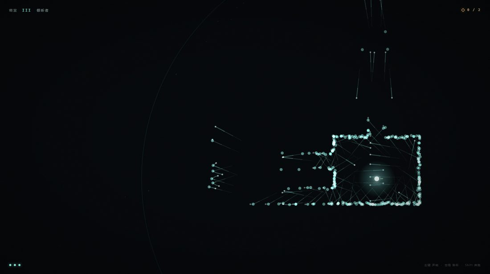
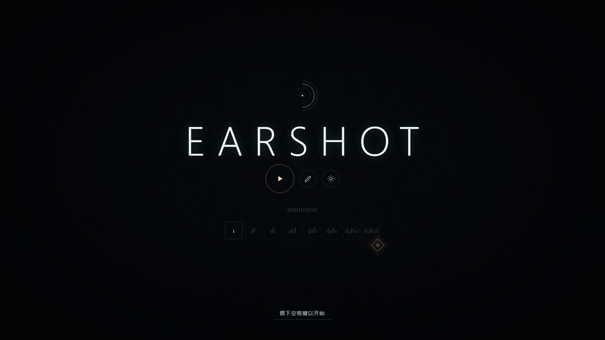
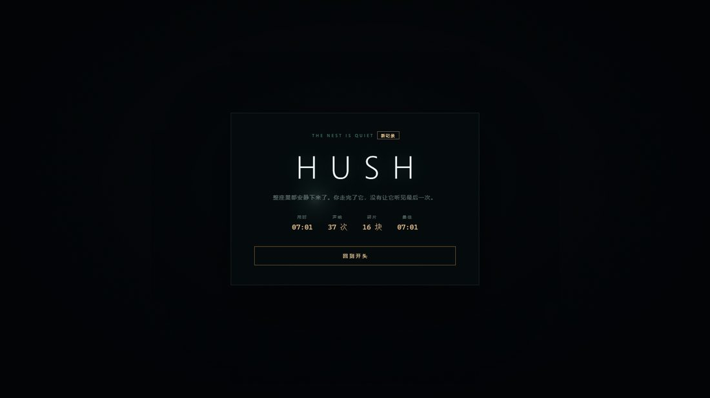

# HUSH

> 你什么都看不见。黑暗在听。
>
> 接手开发请看 [docs/DEVELOPMENT.md](docs/DEVELOPMENT.md)：目录结构、工具链、踩过的坑、下一步计划。

一款用**声呐**当眼睛的极简潜行游戏。发一次脉冲，墙壁的轮廓在黑暗中亮起一瞬——同时，猎手听见了你。

 



*一次脉冲：火花撞墙，撞击点攒出房间的轮廓；同一瞬间，你的位置也传了出去。*

## 开始

**Windows：双击 `play.cmd`（首次会自动挑选空闲端口，并用不缓存的本地服务器打开）** —— 它会自动找一个空闲端口（从 8080 起往后试 60 个），
把服务器拉起来并打开浏览器；如果已经有一个 HUSH 服务器在跑，就直接复用它，
不会因为端口被别的程序占用而打开错误的页面。想指定起始端口：

```bat
play.cmd 9000
```

也可用环境变量 `HUSH_PORT=9000`。

**完全不想起服务器？** 双击 `dist\hush.html` 即可。它是一个把 CSS 与全部模块
内联进去的单文件版本（`npm run build` 生成，约 90 KB），离线和 `file://` 下都能玩。

手动启动（任意静态服务器均可）：

```bash
python -m http.server 8080 --bind 127.0.0.1
# 打开 http://127.0.0.1:8080（被占用就换成 8081、8082…）
```

点击画面 / 摁下空格键开始（第一次点击或按键后声音立即启用）。建议戴耳机。
第一次进入时，底部会一步一步提示声呐、潜行、拾取与投掷的用法。

## 操作

- `WASD` / 方向键 — 移动
- 鼠标左键 / `空格` / `J` — 声呐脉冲（选中投掷物后左键改为掷出）
- `Shift`（按住）— 潜行：移动变慢，几乎不出声
- `Tab` — 背包 / 拖拽装配
- `F` — 互动：拾取道具、拾钥匙、进入传送门、下行；靠近时会有浮窗说明
- `1`–`4` — 快捷键（投掷类按一次选中，再按一次取消）
- `R` — 重开（清空本局，从初始房间重新开始）· `Esc` — 暂停 · `M` — 静音
- 标题页 / 暂停页的齿轮 — 设置：音量、声线亮度、键鼠/手柄切换，以及全部动作的
  自由改键（点一行，再按下新键或手柄按钮）
- 手柄 — 左摇杆移动；默认 A 声呐、B 互动、X 背包、LB 按住潜行、RB/RT/LT/L3
  对应快捷键 1–4、Start 暂停、Back 重开；同样可以自由改键

## 玩法

**主流程是一张连续的巢穴**：一整个洞穴，37 个房间，16 块碎片，10 个猎手，
4 只会学你叫的东西。没有关卡切换、没有加载，房间自己接在一起，跨过一片区域时
左上角只换一个名字。

1. 收集全部**碎片**（它们会响，猎手会被吸引）。敲一次脉冲，1150px 内最近的
   四块碎片会用一声很细的铃声回答你：**延迟是距离，声像是方向**。闭上眼也能
   走——这是游戏里唯一的"地图"。
2. 出口是一扇**回声门**：它不认你一个人的声音。只有当同一声被别的东西从另一个
   方向回答，它才会开。集齐碎片后它会自己轻轻鸣叫，等一个回应。
3. 走到出口。

八个旧密室仍然在标题页下面，可以单独重玩（`?c=0..7`）。

**移动迷宫**是第三张地图（标题页地图选择、`?map=moving`，或从迷宫地图出生点对角的台阶旁传送门进入）：3×3 个 25×25
的方块，每块两层是两套不同的单格宽迷宫，靠门位固定在同一格位里替换。每 20 秒
会抽恰好 5 块换面；**你脚下的房间永远不会被改写**——抽中它就换另一块。房间虽然
没动，HUD 与播报仍会把你带到另一层。翻之前 1 秒，每个门洞会冒出一排红声线，那是
唯一预告。每块中心的三条 120° 声线各是一颗粒子，在正中那一格里以声呐 1/3 的速度反复反弹，粒子不消失、只淡出拖尾；
打碎它，这一间就不再动。走到
对角那一间的二层，按 F 可以让整座迷宫停摆。至于先去敲碎 `b2` 那颗金色的：一圈金
声线会从中心荡开，逐圈拆掉中央房间的内墙——过场期间谁也动不了，被扫到的守卫会碎
成紫声线；等坍塌落定，八道门通向实验室。

**实验室**是隐藏地图，不出现在标题选择里：三个区域首尾相接，每个区域的主路有
5 或 7 间房，大小不一，房间里还砌着不贴外墙的短墙和立柱；中段向下延伸出一条
2/3 间房的岔路，尽头是 8×12 的门禁卡房；主路终点的门要用本区门禁卡刷开。
第二、三区的起点是没有内饰的 5×5 内径消毒间——进去会洗净眩晕与毒雾，任何怪物
都进不来。房间里约十分之一的内墙嵌着培养皿，打碎会荡开墨绿声呐；约五分之一
的地面是毒雾——雾本身看不见，只能从穿过去的声线变成墨绿来判断。实验体 i 型
像普通猎手，ii 型游荡时脚步会出声、听见动静就蓄力冲撞，iii 型贴着墙无声巡逻、
听见声音后先沿墙根跑到离你最近的墙，原地蓄力两秒再扑过来。

三种速度决定你会不会被听见：潜行几乎无声、走路 215px、奔跑 340px。猎手没发现你
时只有你七成的速度，一旦听见声音就翻倍追来，所以**听见了就要停、绕，或者跑**——
站着不动才是真正的隐身。

## 它长什么样

| | |
|---|---|
|  |  |
| 标题：一张连续的巢穴，16 块碎片 | 拟声者替你回答了门（红色那只不是猎手） |

通关时它只说一句：整座巢都安静下来了。



## 项目结构

```
index.html        入口
style.css         视觉与 UI
src/
  main.js         启动
  game.js         状态机、模拟、胜负
  render.js       声呐渲染器
  levelgen.js     程序化房间 / 单张大地图生成
  pathfind.js     A* / 视线检测
  entities.js     玩家、猎手、拟声者
  audio.js        WebAudio 程序化音频
  ui.js           DOM 界面
  chambers.js     8 个旧密室配置（世界模式的区域名也用它）
  util.js         数学 / 随机数
tests/            node --test 逻辑测试
DESIGN.md         设计与数值
```

## 开发

```bash
npm test            # 逻辑测试（关卡连通性、寻路、碰撞、猎手 AI）
npm run build       # 生成 dist/hush.html 单文件版
npm run playtest    # 无头浏览器自动试玩（真实按键 + 截图）
npm run balance     # 每个密室的最短步行路线（配速参考）
npm run pressure    # 幽灵模拟：贪心路线走完每关，统计存活率
npm run perf        # 1080p 帧时间（含 5 猎手 + 脉冲）
npm run serve       # 本地服务器
```

调试用 URL 参数：`?c=0..7` 直接进关、`?static` 关闭入场动画、`?ping` 自动脉冲、`?sim=秒` 快进模拟、`?freeze=毫秒` 定格、`?doc=dead|clear|victory` 预览结算界面。

## 版本

见 [CHANGELOG.md](CHANGELOG.md)。

- **v0.3.7** 标题交代世界、死亡记住你走到哪、声像按距离归一
- **v0.3.2–0.3.5** 单张巢穴成为主流程、碎片用铃声回答脉冲、区域滑音
- **v0.3.0–0.3.1** 火花声呐、拟声者与回声门
- **v0.2** 四种空间风格、聆听必须站定、方向箭头修复
- **v0.1.1** 声音提示、结算面板修正、自动化试玩、Windows 一键启动
- **v0.1** 可玩核心：声呐渲染、8 密室、猎手 AI、程序化音频、存档

## v0.4 操作（无文字界面）

- **WASD** 移动；每走几步会自己发出小声线。
- **Shift** 切换潜行：无声，也全盲——这是你唯一"不被听见"的方式，也是唯一"什么都看不见"的方式。
- **空格**（或左键）发声呐：火花撞墙画出房间，撞到东西会变色反弹。
- 金色 = 碎片，绿色 = 门，红色 = 会杀你的东西。
- 标题上的 **铅笔** = 创造模式：画墙（左键）、擦（右键/橡皮）、放碎片/门/猎手/拟声者/出生点，▶ 直接试玩。
